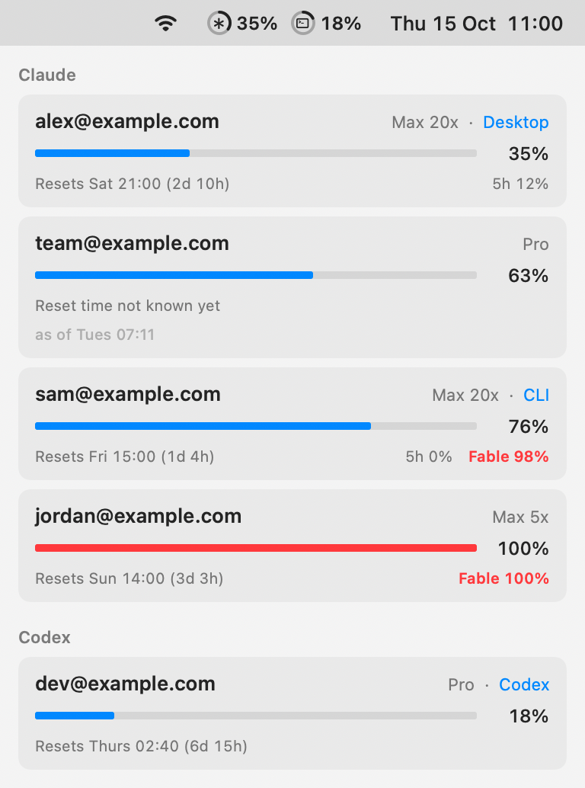
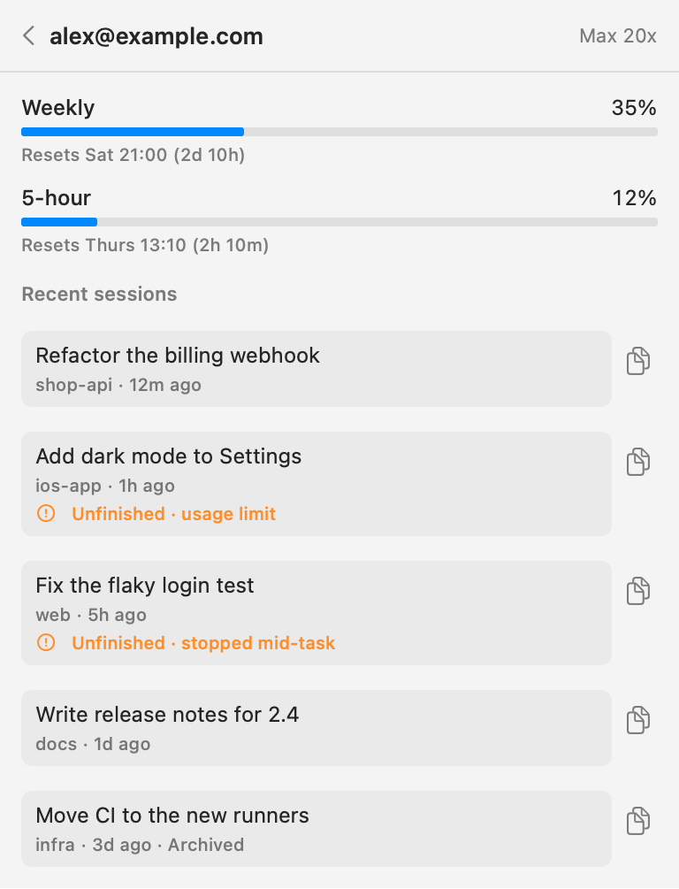

# Headroom

Headroom is a macOS menu bar app that shows how much Claude and Codex usage
each of your accounts has left, and when it resets.



## How it works

- **Menu bar.** One ring for Claude and one for Codex, filled to the weekly
  usage of the account you're signed in to. A ring turns orange at 80% and
  red at 95%.
- **Accounts.** Click the rings to see every Claude and Codex account used on
  this Mac: its plan, where it's signed in, its weekly and 5-hour usage, any
  single-model limit, and when each one resets.
- **Sessions.** Click an account to see its 15 newest Claude Code and Codex
  conversations. One that stopped early, at a usage limit, on an error, when
  it was interrupted or partway through a task, is marked Unfinished.
- **Handoff.** The copy button puts a conversation on the clipboard as
  Markdown. Paste it into a session in an account that still has usage and
  carry on from there.



## What it reads and sends

Headroom reads the sign-ins that the Claude desktop app, Claude Code and Codex
keep on your Mac, and uses them to ask Anthropic and OpenAI for each account's
usage. For the desktop app, macOS asks whether Headroom may use the "Claude
Safe Storage" keychain item. The usage endpoints aren't documented public
APIs, so they can change without notice.

To list sessions, Headroom reads the transcripts in `~/.claude` and `~/.codex`.
It never changes Claude's or Codex's files and keeps tokens only in memory.
Its own record of accounts, emails and last readings stays in
`~/Library/Application Support/Headroom`. It sends nothing anywhere else.

## Build

Needs macOS 14 and Xcode 16 or later.

```sh
swift test
scripts/build-app.sh
```

This installs Headroom in `~/Applications`, turns on Launch at Login and opens
it. If your menu bar is full, open Headroom again from Spotlight to get a
window.

Headroom is not affiliated with Anthropic or OpenAI.

## License

MIT. See [LICENSE](LICENSE).
